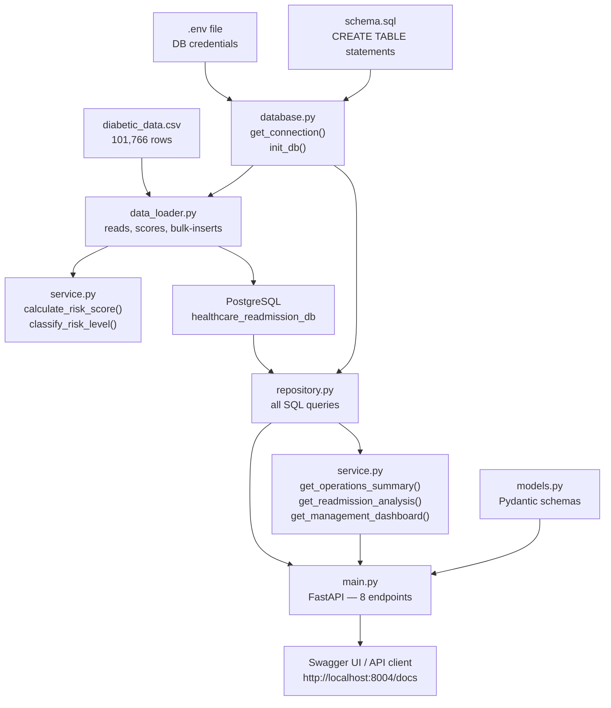
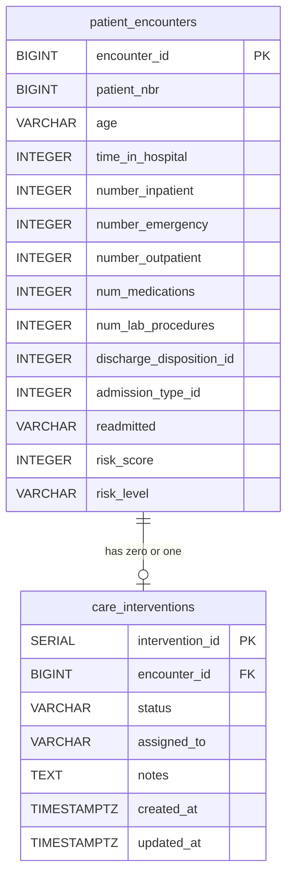

# README_EXPLAINED.md — Complete Learning Guide

## Diabetes Readmission Intervention Queue

**Testleaf FDE Week 2 Mini Project — Comprehensive Explanation**

This document explains every decision, every line of code, and every concept in this project.
It is written for someone who understands basic programming but is building their first enterprise
backend application.

---

## Table of Contents

1. [Project Introduction](#1-project-introduction)
2. [Understanding the Dataset](#2-understanding-the-dataset)
3. [How Risk Scoring Works](#3-how-risk-scoring-works)
4. [Complete Application Architecture](#4-complete-application-architecture)
5. [Explanation of Every Python File](#5-explanation-of-every-python-file)
6. [Understanding PostgreSQL](#6-understanding-postgresql)
7. [Understanding the Data Loader](#7-understanding-the-data-loader)
8. [Understanding FastAPI](#8-understanding-fastapi)
9. [Explain All 8 FastAPI Endpoints](#9-explain-all-8-fastapi-endpoints)
10. [Care-Management Workflow](#10-care-management-workflow)
11. [Operational Analytics and Readmission Analysis](#11-operational-analytics-and-readmission-analysis)
12. [Testing the Application](#12-testing-the-application)
13. [How to Run the Entire Application](#13-how-to-run-the-entire-application)
14. [Troubleshooting](#14-troubleshooting)

---

## 1. Project Introduction

### What is the Diabetes Readmission Intervention Queue?

A hospital sees hundreds of diabetic patients every day. When a patient is discharged (sent home),
there is a risk they will return to the hospital within 30 days — sometimes because their condition
was not properly managed after discharge, sometimes because they did not follow up with their doctor,
sometimes because no one called to check on them.

This application is a **care-management workflow tool**. Its job is to:

1. Ingest 101,766 historical patient encounters from a CSV file into a PostgreSQL database
2. Calculate a **risk score** for every encounter based on the patient's prior healthcare utilization
3. Build a **prioritized queue** of patients (MEDIUM and HIGH risk) who a care team should review
4. Let the care team **update the status** of their outreach as they work through the queue
5. Provide **operational metrics** so hospital management knows how full the backlog is
6. Provide **retrospective analysis** to evaluate whether the scoring rule correlates with actual readmissions

### What is hospital readmission?

**Readmission** means a patient who was already discharged from the hospital comes back and is
admitted again. In the US healthcare system, hospitals face financial penalties when Medicare patients
are readmitted within 30 days. More importantly, frequent readmissions often indicate that something
went wrong in the discharge process: the patient did not understand their care plan, could not afford
their medications, had no one at home to help them, or developed complications that could have been
caught with a phone call.

### Why does returning within 30 days matter?

The 30-day window is a regulatory and clinical benchmark. The US Hospital Readmissions Reduction
Program (HRRP) penalizes hospitals with above-average 30-day readmission rates for conditions
including diabetes. A readmission within 30 days is generally treated as preventable — something
a proactive care team might have avoided with an outreach call or a follow-up appointment.

### What business problem are we solving?

The hospital has **too many patients and not enough care coordinators**. If every discharged patient
received a follow-up call, the team would be overwhelmed and the calls would not be targeted at the
patients who need them most.

The problem this application solves is: **which patients should we call first?**

A scoring rule, based on prior utilization patterns (how many times a patient was in the ER, how
many inpatient stays they had, how long they stayed), assigns every encounter a risk score. The care
team only needs to work the MEDIUM and HIGH risk queue — 8,538 out of 101,766 encounters, or about
8.4% of all discharges.

### Who will use this application?

| User | Role | What they use |
|---|---|---|
| Care coordinator | Calls high-risk patients after discharge | `GET /care-queue`, `PATCH /interventions/{id}` |
| Operations manager | Monitors team workload and backlog | `GET /operations/summary` |
| Clinical analyst | Evaluates whether the scoring rule works | `GET /operations/readmission-analysis` |
| Hospital executive | Sees the big picture | `GET /management/dashboard` |
| Data engineer | Loads the CSV, runs tests, maintains the system | `data_loader.py`, pytest |

### What happens if this application does not exist?

Without this application, a care coordinator would need to:

- Manually download the CSV from the EHR (Electronic Health Records) system
- Open it in Excel
- Sort by "highest risk" — except there is no risk score in the original CSV, so they have no way to sort
- Call patients in whatever order they happen to be in the spreadsheet
- Write their notes somewhere else, with no connection to the patient record
- Have no way to tell their manager how many patients are still in the backlog

The result is **no prioritization, no tracking, no analytics**.

### A realistic hospital scenario with five fictional patients

Imagine the hospital discharges these five patients on the same day:

| Patient | Situation | What happens without the app | What happens with the app |
|---|---|---|---|
| **Maria Chen**, 68 | Third inpatient stay this year, 2 ER visits, 22 medications | Nobody calls — she's in row 47,821 of the spreadsheet | Score 7 (HIGH) → appears at the top of the care queue → coordinator calls within 24 hours |
| **James Okafor**, 55 | First ever hospital stay, no ER visits, 5 medications | Nobody calls — same backlog problem | Score 0 (LOW) → not in the queue → no wasted coordinator time |
| **Priya Rajan**, 72 | Two prior inpatient stays, 1 ER visit, 10 days in hospital this time | Coordinator might get to her eventually | Score 4 (MEDIUM) → in the queue → called within a week |
| **Tom Briggs**, 44 | First admission, short stay, few medications | Randomly called because he's near the top of the sheet | Score 0 (LOW) → correctly excluded from the queue |
| **Grace Mbeki**, 63 | 4 prior inpatient stays, 3 ER visits, long stay, 25 medications | Never called — her row is buried | Score 8 (HIGH) → rank 1 in the queue → first call of the day |

The application turns an unmanageable spreadsheet problem into a structured, queryable workflow.

---

## 2. Understanding the Dataset

### What is diabetic_data.csv?

This file comes from the UCI Machine Learning Repository: **Diabetes 130-US hospitals for years
1999–2008**. It contains 101,766 rows, one for each patient **encounter** at 130 US hospitals over
a 10-year period. It was originally assembled for research into factors that predict 30-day
readmissions.

The file has 50 columns. This application uses 12 of them, ignoring the rest.

### What is an encounter?

An **encounter** is a single hospital admission. It is not a patient — it is one *visit*.

Example: Maria Chen was admitted three times this year. Each admission is a separate row in the CSV
with a different `encounter_id`. All three rows share the same `patient_nbr` because they all
belong to Maria.

### Difference between `encounter_id` and `patient_nbr`

| Field | What it identifies | Is it unique? |
|---|---|---|
| `encounter_id` | One specific hospital visit | Yes — every row has a different `encounter_id` |
| `patient_nbr` | One specific patient | No — a patient with multiple admissions appears in multiple rows with the same `patient_nbr` |

If you see `patient_nbr = 8299552` in 3 rows, that is one patient who was admitted 3 times.
Each row captures what happened during that specific admission.

### Why are there 101,766 encounters?

The dataset spans 10 years across 130 hospitals. Many patients appear multiple times. The 101,766
figure is the count of *admissions*, not unique patients. The number of distinct `patient_nbr`
values is smaller.

### What do the 12 required columns represent?

The data loader requires exactly these 12 columns (defined in `REQUIRED_COLUMNS` in `data_loader.py`):

| Column | Type | Example | What it means |
|---|---|---|---|
| `encounter_id` | Integer | 2278392 | Unique ID for this hospital visit |
| `patient_nbr` | Integer | 8299552 | Unique ID for the patient (same across visits) |
| `age` | String | `[50-60)` | Age bracket at the time of this encounter |
| `time_in_hospital` | Integer | 3 | Days spent in the hospital during this stay |
| `number_inpatient` | Integer | 0 | Prior inpatient admissions in the past year |
| `number_emergency` | Integer | 0 | Prior emergency visits in the past year |
| `number_outpatient` | Integer | 0 | Prior outpatient visits in the past year |
| `num_medications` | Integer | 18 | Number of distinct medications during this stay |
| `num_lab_procedures` | Integer | 41 | Number of lab tests performed |
| `discharge_disposition_id` | Integer | 1 | Coded destination after discharge (e.g., 1 = home) |
| `admission_type_id` | Integer | 6 | Coded admission type (e.g., 1 = emergency, 3 = elective) |
| `readmitted` | String | `NO` | Was the patient readmitted? `NO`, `<30`, or `>30` |

The data loader calls `sys.exit()` if any of these 12 columns are missing from the CSV header.
This protects against accidentally loading the wrong file.

### Which columns are used for scoring?

Only these five are passed to `calculate_risk_score()`:

- `number_inpatient`
- `number_emergency`
- `number_outpatient`
- `time_in_hospital`
- `num_medications`

The other seven columns (`encounter_id`, `patient_nbr`, `age`, `num_lab_procedures`,
`discharge_disposition_id`, `admission_type_id`, `readmitted`) are **stored** in the database
but play no part in computing the risk score.

### What does readmitted = NO, <30, >30 mean?

| Value | Meaning |
|---|---|
| `NO` | Patient was not readmitted at all within the observation period |
| `<30` | Patient returned to hospital within 30 days (the "bad" outcome) |
| `>30` | Patient returned, but more than 30 days later |

**This is the historical outcome** — what actually happened after the patient was discharged.
It is known only because researchers collected data retroactively.

### Why is the historical outcome excluded from scoring?

This is one of the most important design decisions in the project, and it is enforced in code.

Using `readmitted` to compute the risk score would be **data leakage**. Here is why:

When a care coordinator looks at a newly discharged patient, **we do not know yet** whether they
will be readmitted. That information only exists after the fact. If the scoring formula used
`readmitted`, the score would be based on a fact that is unknowable at decision time.

The correct use of `readmitted` is **retrospective evaluation**: after scoring all 101,766
historical encounters without using `readmitted`, we can look back and ask "did HIGH-risk patients
historically have higher readmission rates?" The answer is yes (28.6% vs 10.0% for LOW risk).
This tells us the scoring rule has some signal, even though it was never trained on `readmitted`.

The code enforces this at three levels:
1. `calculate_risk_score()` does not accept a `readmitted` parameter (enforced by a unit test using `inspect.signature`)
2. `EncounterOut` and `CareQueueItem` Pydantic models do not include a `readmitted` field
3. `readmitted` appears in SQL exactly once: in `get_readmission_by_risk_level()` in `repository.py`, only for the retrospective analysis endpoint

---

## 3. How Risk Scoring Works

### The official TestLeaf scoring algorithm

Every encounter is scored on five conditions. Each condition either fires or does not — there is
no partial credit. The conditions are checked independently and the points add up.

| Condition | Threshold | Points | Reasoning |
|---|---|---|---|
| `number_inpatient >= 3` | 3 or more prior inpatient stays | **+3** | Frequent hospitalizations are the strongest predictor |
| `number_emergency >= 2` | 2 or more prior ER visits | **+2** | Emergency use indicates poor disease control |
| `number_outpatient >= 3` | 3 or more prior outpatient visits | **+1** | Active engagement with the system |
| `time_in_hospital >= 7` | 7 or more days in the current stay | **+1** | Longer stays suggest more complex illness |
| `num_medications >= 20` | 20 or more medications during stay | **+1** | High medication burden suggests clinical complexity |

**Minimum possible score:** 0 (no conditions fire)
**Maximum possible score:** 8 (all conditions fire)

### Risk tiers

| Score range | Risk level | Action |
|---|---|---|
| 0 – 2 | LOW | Not in care queue — no proactive outreach |
| 3 – 4 | MEDIUM | In care queue — outreach within a week |
| 5 – 8 | HIGH | In care queue — priority outreach |

### Five fictional encounter examples with step-by-step calculations

**Example 1: Grace Mbeki (score = 8, HIGH)**

```
number_inpatient = 6   → 6 >= 3 → YES → +3
number_emergency = 3   → 3 >= 2 → YES → +2
number_outpatient = 5  → 5 >= 3 → YES → +1
time_in_hospital = 9   → 9 >= 7 → YES → +1
num_medications = 25   → 25 >= 20 → YES → +1
                                    TOTAL = 8  → HIGH
```

**Example 2: Maria Chen (score = 7, HIGH)**

```
number_inpatient = 3   → 3 >= 3 → YES → +3
number_emergency = 2   → 2 >= 2 → YES → +2
number_outpatient = 1  → 1 >= 3 → NO  →  0
time_in_hospital = 10  → 10 >= 7 → YES → +1
num_medications = 22   → 22 >= 20 → YES → +1
                                    TOTAL = 7  → HIGH
```

**Example 3: Priya Rajan (score = 4, MEDIUM)**

```
number_inpatient = 3   → 3 >= 3 → YES → +3
number_emergency = 1   → 1 >= 2 → NO  →  0
number_outpatient = 0  → 0 >= 3 → NO  →  0
time_in_hospital = 10  → 10 >= 7 → YES → +1
num_medications = 12   → 12 >= 20 → NO →  0
                                    TOTAL = 4  → MEDIUM
```

**Example 4: James Okafor (score = 2, LOW)**

```
number_inpatient = 0   → 0 >= 3 → NO  →  0
number_emergency = 2   → 2 >= 2 → YES → +2
number_outpatient = 0  → 0 >= 3 → NO  →  0
time_in_hospital = 4   → 4 >= 7 → NO  →  0
num_medications = 8    → 8 >= 20 → NO →  0
                                    TOTAL = 2  → LOW
```

**Example 5: Tom Briggs (score = 0, LOW)**

```
number_inpatient = 0   → 0 >= 3 → NO  →  0
number_emergency = 0   → 0 >= 2 → NO  →  0
number_outpatient = 1  → 1 >= 3 → NO  →  0
time_in_hospital = 2   → 2 >= 7 → NO  →  0
num_medications = 5    → 5 >= 20 → NO →  0
                                    TOTAL = 0  → LOW
```

### Why are these prototype prioritization rules rather than medically validated predictions?

There are several important limitations:

**The weights are assumptions, not evidence.** No statistical analysis was performed to determine
that `number_inpatient >= 3` deserves 3 points while `time_in_hospital >= 7` deserves only 1.
These thresholds and weights were designed to produce a reasonable distribution across the dataset
and to be explainable, not to maximize predictive accuracy.

**The thresholds are binary.** A patient with `number_inpatient = 2` gets 0 points; a patient with
`number_inpatient = 3` gets 3 points. In reality, 2 prior admissions is almost as significant as 3.

**The rule is not trained.** A machine learning model trained on the same dataset and evaluated
on a held-out set would almost certainly outperform this rule. However, an ML model is less
explainable — you cannot look at a patient and say "here is exactly why they are HIGH risk."

**Clinical factors are missing.** The scoring rule knows nothing about the patient's diagnosis
codes, A1C levels, insurance status, social support system, or medication adherence. All of these
are known predictors of readmission in the clinical literature.

**The dataset is historical.** The 101,766 encounters span 1999–2008. Patient demographics,
treatment protocols, and medication landscapes have all changed since then.

The design intent is that this rule serves as a **starting point for a conversation** between the
data engineering team and the clinical team, not as a deployed clinical decision tool.

---

## 4. Complete Application Architecture

### Data flow

```
diabetic_data.csv (101,766 rows)
        ↓
  data_loader.py
  ├── reads CSV with csv.DictReader
  ├── validates 12 required columns present
  ├── calls calculate_risk_score() from service.py
  ├── calls classify_risk_level() from service.py
  └── inserts batches into PostgreSQL (2,000 rows at a time)
        ↓
PostgreSQL database: healthcare_readmission_db
  ├── patient_encounters (101,766 rows)
  └── care_interventions (8,538 rows — MEDIUM + HIGH only)
        ↓
  repository.py (all SQL queries live here)
        ↓
  service.py (business logic, metrics assembly)
        ↓
  main.py (FastAPI — 8 HTTP endpoints)
        ↓
Swagger UI at http://localhost:8004/docs
(or any API client: curl, Postman, a React frontend, etc.)
```

### Architecture diagram



### Why use separate layers?

An application that puts SQL queries inside FastAPI endpoint functions, business logic inside the
database layer, and CSV parsing mixed with HTTP handling is possible — but it becomes very hard to
test, change, and debug.

This project uses a layered architecture where each layer has one job:

| Layer | File | Job | Knows about |
|---|---|---|---|
| Infrastructure | `database.py` | Open database connections | PostgreSQL credentials |
| Schema | `schema.sql` | Define tables | Nothing in Python |
| Data ingestion | `data_loader.py` | Load CSV to DB | CSV format, DB schema |
| Data access | `repository.py` | Run SQL queries | PostgreSQL, connection management |
| Business logic | `service.py` | Score encounters, assemble metrics | Repository (for metrics only) |
| HTTP models | `models.py` | Define request/response shapes | Pydantic validation rules |
| HTTP interface | `main.py` | Handle HTTP requests | Repository, service, models |

**The benefit:** `service.py`'s `calculate_risk_score()` can be tested with pure Python, no
database, no FastAPI, no CSV. You pass in five integers and get back a score. This makes the
tests fast, reliable, and easy to understand.

---

## 5. Explanation of Every Python File

### 5.1 `database.py`

**Purpose:** The single place where the application connects to PostgreSQL. Every other file that
needs the database calls `get_connection()` from here. No other file stores database credentials.

**How it works:**

```python
# Load .env from this project's own directory
load_dotenv(Path(__file__).parent / ".env")
```

`Path(__file__).parent` means "the directory containing this file" — i.e., the
`healthcare-readmission-mvp/` folder. Using `Path(__file__).parent` instead of a relative path
like `".env"` ensures the file is found correctly regardless of which directory you run Python
from.

```python
DB_CONFIG = {
    "host":     os.getenv("DB_HOST", "localhost"),
    "port":     int(os.getenv("DB_PORT", 5432)),
    "dbname":   os.getenv("DB_NAME", "healthcare_readmission_db"),
    "user":     os.getenv("DB_USER", "fde_user"),
    "password": os.getenv("DB_PASSWORD", ""),
}
```

`os.getenv("DB_HOST", "localhost")` reads the `DB_HOST` variable from the environment (which
`load_dotenv` populated from `.env`). The second argument is the **default value** used if the
variable is not set. This means the app works locally with sensible defaults even if `.env` is
partially configured.

**`get_connection()`** opens and returns a live `psycopg.Connection`. The caller is responsible
for closing it (all callers in `repository.py` use `with get_connection() as conn:` which
auto-closes when the `with` block exits).

**`init_db()`** reads `schema.sql` from disk and executes it. Because `schema.sql` uses
`CREATE TABLE IF NOT EXISTS`, running this repeatedly is safe — it creates the tables on the
first call and does nothing on subsequent calls.

**Interacts with:** `.env`, `schema.sql`
**Called by:** `repository.py`, `data_loader.py`, `tests/conftest.py`

---

### 5.2 `models.py`

**Purpose:** Define the **shapes** of data entering and leaving the API. FastAPI uses these
Pydantic models to automatically validate requests, serialize responses, and generate the
Swagger UI documentation.

**`InterventionStatus` (Enum)**

```python
class InterventionStatus(str, Enum):
    PENDING_REVIEW = "PENDING_REVIEW"
    ASSIGNED = "ASSIGNED"
    CONTACTED = "CONTACTED"
    FOLLOW_UP_SCHEDULED = "FOLLOW_UP_SCHEDULED"
    CLOSED = "CLOSED"
```

An `Enum` is a fixed set of allowed values. By inheriting from both `str` and `Enum`, FastAPI
can validate that a string like `"ASSIGNED"` maps to this enum, and return a 422 error if someone
sends `"DONE"` (which is not in the enum).

**`EncounterOut`** — the response shape for `GET /encounters` and `GET /encounters/{id}`.
Notice that `readmitted` is intentionally absent. The comment explains why: it is the historical
outcome and must never appear in operational API responses.

**`CareQueueItem`** — the response shape for `GET /care-queue` and `GET /care-queue/high`.
It contains the encounter's clinical fields (risk_score, risk_level) joined with the intervention's
workflow fields (status, assigned_to, notes, created_at, updated_at).

**`InterventionPatch`** — the request body for `PATCH /interventions/{id}`.

```python
@model_validator(mode="after")
def at_least_one_field(self) -> "InterventionPatch":
    if self.status is None and self.assigned_to is None and self.notes is None:
        raise ValueError("At least one of status, assigned_to, or notes must be provided.")
    return self
```

`model_validator(mode="after")` is a Pydantic v2 feature. It runs **after** all individual field
validations. If a request arrives with `{}` (an empty body), this validator fires and raises a
`ValueError`, which FastAPI converts to a 422 response. This prevents silent no-op PATCH requests.

**`ReadmissionAnalysis`** includes a mandatory `note: str` field. Every response from the
retrospective analysis endpoint includes an explicit disclaimer: "readmitted is the historical
outcome. It was NOT used to calculate risk_score or risk_level." This ensures that any downstream
system or API consumer cannot accidentally treat the analysis as a clinical validation.

**Interacts with:** `main.py` (FastAPI uses these as `response_model` and request body types)

---

### 5.3 `service.py`

**Purpose:** The business logic layer. This file contains the risk-scoring algorithm and the
metric assembly functions. Critically, it has **no direct database calls** for the scoring
functions — they are pure Python functions that take numbers and return numbers.

**`calculate_risk_score()`**

```python
def calculate_risk_score(
    number_inpatient: int,
    number_emergency: int,
    number_outpatient: int,
    time_in_hospital: int,
    num_medications: int,
) -> int:
```

Five parameters — all integers. No `readmitted` parameter. No database calls. No CSV logic.
This is a pure function: same inputs always give the same output. This makes it trivially unit-testable.

**`classify_risk_level(risk_score: int) -> str`**

Takes a score (0–8) and returns `"LOW"`, `"MEDIUM"`, or `"HIGH"`.

**`score_encounter(enc: dict) -> tuple[int, str]`**

A convenience wrapper that accepts a dictionary (a row from the CSV or database) and extracts the
five scoring fields, then calls `calculate_risk_score()` and `classify_risk_level()`. It handles
string-to-int conversion because CSV values come in as strings.

**The import-at-the-bottom pattern:**

```python
import repository as _repo  # local import to avoid circular dependency at module level
```

`service.py` is imported by `data_loader.py` for its scoring functions. `repository.py` imports
`database.py`. If `service.py` imported `repository` at the top of the file, Python might try
to resolve all imports during module load and run into a circular dependency. Placing the import
at the point where it is first used avoids this.

**`get_operations_summary()`, `get_readmission_analysis()`, `get_management_dashboard()`**

These Phase 5 functions act as **assemblers**: they call one or more repository queries, perform
arithmetic (calculate percentages, compute ratios, check for division by zero), and return
structured dictionaries that Pydantic models will validate before FastAPI sends them as JSON.

**Interacts with:** `repository.py` (for Phase 5 metrics), called by `data_loader.py` and `main.py`

---

### 5.4 `repository.py`

**Purpose:** All SQL lives here. No SQL appears anywhere else in the application. Every query is
parameterized. No business logic appears here — just database operations.

**`_row_to_dict(cur, row)`**

A private helper function. After `cur.execute()`, `cur.description` contains metadata about the
columns that were returned. This function converts a raw tuple like `(67162368, 8299552, '[50-60)', ...)` 
into a dict like `{"encounter_id": 67162368, "patient_nbr": 8299552, "age": "[50-60)", ...}`.
Without this, the service layer would need to know the column order of every query — fragile and error-prone.

**`get_encounters(limit, offset)`**

Returns a page of encounters. `LIMIT %s OFFSET %s` implements pagination. Notice that `readmitted`
is not in the `SELECT` list.

**`get_care_queue(risk_levels)`**

```python
placeholders = ", ".join(["%s"] * len(risk_levels))
sql = f"""
    ...
    WHERE  pe.risk_level IN ({placeholders})
    ...
    LIMIT  500
"""
```

The f-string constructs the `IN` clause — but the values inside the parentheses are `%s`
placeholders, not raw user input. The actual values are passed separately as `risk_levels`.
This is safe because the f-string only controls how many `%s` markers appear, which comes
from the length of a list we control in our own code (`["MEDIUM", "HIGH"]`).

The `LIMIT 500` cap is an MVP decision. With 8,538 MEDIUM+HIGH encounters, returning all of them
in one HTTP response would be slow and use a lot of memory. 500 is a pragmatic limit.

**`update_intervention(encounter_id, fields)`**

```python
_INTERVENTION_UPDATABLE = {"status", "assigned_to", "notes"}

updates = {
    k: v for k, v in fields.items()
    if k in _INTERVENTION_UPDATABLE and v is not None
}
set_clause = ", ".join(f"{col} = %s" for col in updates) + ", updated_at = NOW()"
```

Only columns in `_INTERVENTION_UPDATABLE` can appear in the `SET` clause. Even if a malicious
client sent `{"encounter_id": 999, "status": "CLOSED"}`, the `encounter_id` key would be filtered
out. The f-string constructs column names from a hardcoded set, never from user input.

The `RETURNING` clause at the end of the SQL statement tells PostgreSQL to return the updated row
immediately, so we don't need a second `SELECT` query.

**Interacts with:** `database.py` (for connections), called by `service.py` and `main.py`

---

### 5.5 `main.py`

**Purpose:** The FastAPI application. Defines the 8 HTTP endpoints, maps URLs to Python functions,
and delegates all work to `repository.py` and `service.py`.

**`lifespan` context manager:**

```python
@asynccontextmanager
async def lifespan(app: FastAPI):
    init_db()
    yield
```

This is the modern FastAPI way (replacing the deprecated `@app.on_event("startup")` pattern) to
run code once when the application starts. When uvicorn starts the server, `init_db()` runs,
which executes `schema.sql` and creates the tables if they don't exist. The `yield` is where
the application runs. Anything after `yield` runs when the application shuts down (there's
nothing after `yield` here, so no shutdown logic).

**Endpoint pattern:**

```python
@app.get("/encounters", response_model=list[EncounterOut], tags=["Encounters"])
def list_encounters(
    limit: Annotated[int, Query(ge=1, le=1000, description="Max rows to return")] = 100,
    offset: Annotated[int, Query(ge=0, description="Rows to skip")] = 0,
):
```

- `response_model=list[EncounterOut]` tells FastAPI to validate the return value against this
  Pydantic model before sending it as JSON. If any field is missing or has the wrong type,
  FastAPI raises a 500 error before the response reaches the client.
- `Query(ge=1, le=1000)` means `limit` must be between 1 and 1000 inclusive (`ge` = greater-or-equal,
  `le` = less-or-equal). A request with `?limit=0` returns a 422 error automatically.
- `Annotated[int, Query(...)]` is Pydantic v2 syntax for attaching validation metadata to a type.

**Error handling:**

```python
enc = repo.get_encounter(encounter_id)
if not enc:
    raise HTTPException(status_code=404, detail=f"Encounter {encounter_id} not found")
```

If the repository returns `None` (no row found), `main.py` raises `HTTPException` which FastAPI
converts to a JSON error response: `{"detail": "Encounter 9999999 not found"}` with HTTP 404.

**Interacts with:** `repository.py`, `service.py`, `models.py`, `database.py`

---

### 5.6 `data_loader.py`

**Purpose:** A standalone script (not part of the web server) that reads `diabetic_data.csv`,
scores every encounter, and bulk-inserts data into PostgreSQL. Run it once before starting the API.

See [Section 7](#7-understanding-the-data-loader) for a detailed step-by-step explanation.

**Key constants:**

```python
DATA_FILE = Path(__file__).parent / "data" / "diabetic_data.csv"
BATCH_SIZE = 2000
```

The CSV is expected at `healthcare-readmission-mvp/data/diabetic_data.csv`. `BATCH_SIZE = 2000`
means the loader sends 2,000 rows to PostgreSQL per `executemany()` call instead of all 101,766
at once, which would require very large memory and a very long transaction.

**Interacts with:** `database.py`, `service.py`

---

### 5.7 `schema.sql`

**Purpose:** Defines the two PostgreSQL tables and four indexes. This is not Python — it is SQL
that PostgreSQL executes. The application reads this file and executes it via `init_db()` in
`database.py`.

See [Section 6](#6-understanding-postgresql) for a full explanation of the schema.

---

### 5.8 `requirements.txt`

**Purpose:** Lists the exact Python packages this project needs, with pinned versions.

```
fastapi==0.142.2
uvicorn[standard]==0.54.0
psycopg[binary]==3.3.6
python-dotenv==1.2.4
pydantic==2.13.5
pytest==9.1.1
```

| Package | What it does |
|---|---|
| `fastapi` | The web framework — handles HTTP routing, validation, Swagger generation |
| `uvicorn[standard]` | The ASGI server — runs the FastAPI app and listens for HTTP requests |
| `psycopg[binary]` | The PostgreSQL driver for Python 3 (psycopg v3, not the older psycopg2) |
| `python-dotenv` | Reads `.env` files and loads them into `os.environ` |
| `pydantic` | Data validation — used by FastAPI for request/response models |
| `pytest` | The test runner — discovers and executes test files |

**Why pin exact versions?** Because `fastapi==0.142.3` might introduce a breaking change that
`fastapi==0.142.2` did not have. Exact pins mean "the application is tested and known to work
with exactly this version." Anyone installing from this file gets the same environment.

---

### 5.9 `.env.example`

**Purpose:** A template showing which environment variables the application needs, without
exposing any real passwords. Developers copy this file to `.env` and fill in their real values.

```
DB_HOST=localhost
DB_PORT=5432
DB_NAME=healthcare_readmission_db
DB_USER=fde_user
DB_PASSWORD=your_password_here
```

`.env` is listed in `.gitignore` so it is never committed to GitHub. `.env.example` is committed,
so new developers know exactly what they need to configure.

---

### 5.10 `tests/`

| File | Contents |
|---|---|
| `conftest.py` (project root) | Adds the project directory to Python's import path |
| `tests/__init__.py` | Marks `tests/` as a Python package |
| `tests/conftest.py` | Shared pytest fixtures: `high_encounter_id`, `medium_encounter_id`, `restore_intervention` |
| `tests/test_service.py` | 36 unit tests for the risk-scoring functions |
| `tests/test_endpoints.py` | 32 integration tests for Phase 4 endpoints |
| `tests/test_phase5.py` | 37 integration tests for Phase 5 metric endpoints |

See [Section 12](#12-testing-the-application) for a detailed explanation of every test file.

---

## 6. Understanding PostgreSQL

### What is PostgreSQL?

PostgreSQL (often called "Postgres") is an open-source relational database system. A database
is a program that stores data persistently on disk, lets you query it efficiently, and enforces
rules about what data is allowed. "Relational" means data is organized into **tables** (like
spreadsheets), and the tables can be **related** to each other via shared IDs.

### Why not store everything in Python memory?

If this application stored data in Python variables (a `list` of dictionaries, for example),
every time you stopped and restarted the FastAPI server, all the data would vanish. Every time
a care coordinator updated an intervention status, that update would disappear when the server
restarted.

PostgreSQL stores data on disk. When a care coordinator updates an intervention status at 2pm,
that change is saved to disk. If the server restarts at 3pm, the change is still there. This
property is called **persistence**.

### What are tables, rows, and columns?

Think of a table like a spreadsheet:
- The **table** is the spreadsheet
- Each **row** is one record (one patient encounter)
- Each **column** is one attribute (encounter_id, age, risk_score, etc.)
- **Constraints** are rules that PostgreSQL enforces — for example, `NOT NULL` means a row cannot
  be inserted if that column has no value.

### Primary key vs foreign key

A **primary key** is a column (or set of columns) that uniquely identifies each row in a table.
No two rows can have the same primary key value. In `patient_encounters`, `encounter_id BIGINT PRIMARY KEY`
means every encounter_id must be unique across the whole table.

A **foreign key** is a column that references the primary key of another table. In `care_interventions`:

```sql
encounter_id BIGINT NOT NULL UNIQUE
    REFERENCES patient_encounters(encounter_id) ON DELETE CASCADE
```

This means every `encounter_id` in `care_interventions` must exist in `patient_encounters`. You
cannot create an intervention for an encounter that doesn't exist. If you delete the encounter,
`ON DELETE CASCADE` automatically deletes the intervention too.

### What does UNIQUE mean?

`UNIQUE` on `care_interventions.encounter_id` means there can be at most one intervention row
per encounter. The MVP design decision is that each encounter in the care queue has exactly one
active care-management record.

### What is a database transaction?

A **transaction** is a group of SQL statements that are treated as one unit. Either all of them
succeed, or none of them do. In `data_loader.py`:

```python
with get_connection() as conn:
    with conn.cursor() as cur:
        _insert_batches(cur, enc_sql, encounter_rows)
        _insert_batches(cur, inv_sql, intervention_ids)
    conn.commit()
```

All 101,766 encounter insertions and 8,538 intervention insertions happen within one transaction.
The `conn.commit()` call tells PostgreSQL "everything succeeded, make it permanent." If the
process crashes before `commit()`, PostgreSQL rolls back all the insertions as if they never happened.

### What does COMMIT mean?

`commit()` makes a transaction permanent. Before `commit()`, changes are visible only within
the current connection. After `commit()`, they are saved to disk and visible to all connections.

### What does ON CONFLICT DO NOTHING mean?

```sql
INSERT INTO patient_encounters (...)
VALUES (...)
ON CONFLICT (encounter_id) DO NOTHING
```

If you try to insert a row with an `encounter_id` that already exists in the table, instead of
raising an error, PostgreSQL silently skips the insertion. This makes the data loader **idempotent**:
running it twice produces the same result as running it once. The second run detects all the
conflicts and skips all insertions.

### The two project tables

**`patient_encounters`** — one row per hospital visit from the CSV

```
encounter_id  | patient_nbr | age      | time_in_hospital | ... | readmitted | risk_score | risk_level
--------------+-------------+----------+------------------+-----+------------+------------+-----------
2278392       | 8299552     | [50-60)  | 1                | ... | NO         | 0          | LOW
67162368      | 71658174    | [70-80)  | 14               | ... | <30        | 8          | HIGH
2552952       | 89382658    | [60-70)  | 7                | ... | >30        | 4          | MEDIUM
```

**`care_interventions`** — one row per MEDIUM or HIGH encounter; LOW encounters have no row

```
intervention_id | encounter_id | status          | assigned_to  | notes                   | created_at          | updated_at
----------------+--------------+-----------------+--------------+-------------------------+---------------------+---------------------
1               | 67162368     | PENDING_REVIEW  | NULL         | NULL                    | 2026-10-05 09:12:00 | 2026-10-05 09:12:00
2               | 2552952      | ASSIGNED        | Care Team A  | Called, no answer       | 2026-10-05 09:12:00 | 2026-10-06 14:30:00
```

### How the two tables connect

The `encounter_id` column in `care_interventions` is a foreign key pointing to `patient_encounters`.
The `JOIN` in `get_care_queue()` combines these two tables into one result:

```sql
SELECT pe.encounter_id, pe.risk_score, ci.status, ci.assigned_to
FROM   patient_encounters pe
JOIN   care_interventions ci ON pe.encounter_id = ci.encounter_id
WHERE  pe.risk_level IN ('MEDIUM', 'HIGH')
```

### Entity-Relationship diagram



One encounter can have zero interventions (LOW risk) or exactly one intervention (MEDIUM/HIGH risk).

### Four indexes

The schema creates four indexes to speed up common queries:

| Index | Column | Purpose |
|---|---|---|
| `idx_pe_risk_level` | `patient_encounters.risk_level` | Speeds up `WHERE risk_level IN (...)` — used by every care-queue query |
| `idx_pe_patient_nbr` | `patient_encounters.patient_nbr` | Speeds up looking up all encounters for one patient |
| `idx_ci_status` | `care_interventions.status` | Speeds up `GROUP BY status` in the metrics query |
| `idx_ci_encounter_id` | `care_interventions.encounter_id` | Speeds up the JOIN between the two tables |

Without indexes, PostgreSQL would need to scan every row in the table for each query. With indexes,
it can jump directly to the matching rows — much faster on 101,766 rows.

---

## 7. Understanding the Data Loader

### Step-by-step explanation of `data_loader.py`

**Step 1: Check the file exists**

```python
DATA_FILE = Path(__file__).parent / "data" / "diabetic_data.csv"

if not DATA_FILE.exists():
    sys.exit(f"Dataset not found: {DATA_FILE}")
```

If the CSV file is not found at `healthcare-readmission-mvp/data/diabetic_data.csv`, the script
exits immediately with a clear error message. `sys.exit()` stops the Python process with a
non-zero exit code, which CI/CD pipelines interpret as failure.

**Step 2: Open the CSV and validate column names**

```python
with open(DATA_FILE, newline="", encoding="utf-8") as f:
    reader = csv.DictReader(f)
    missing = REQUIRED_COLUMNS - set(reader.fieldnames or [])
    if missing:
        sys.exit(f"CSV is missing required columns: {missing}")
```

`csv.DictReader` reads each row as a dictionary where the keys are the column headers from the
first line of the file. Before reading any rows, it checks that all 12 required columns exist in
the header. The `REQUIRED_COLUMNS - set(...)` performs a set difference: any required columns not
in `reader.fieldnames` end up in `missing`.

**Step 3: For each row, call the scoring function**

```python
for row in reader:
    score = calculate_risk_score(
        number_inpatient=int(row["number_inpatient"]),
        number_emergency=int(row["number_emergency"]),
        number_outpatient=int(row["number_outpatient"]),
        time_in_hospital=int(row["time_in_hospital"]),
        num_medications=int(row["num_medications"]),
    )
    level = classify_risk_level(score)
```

All CSV values come in as strings. `int(row["number_inpatient"])` converts the string `"3"` to
the integer `3` before passing it to `calculate_risk_score()`. If a field contained a non-numeric
value, this would raise a `ValueError`. The data in this dataset is clean enough that no extra
validation is needed.

**Step 4: Build tuples for batch insertion**

```python
encounter_rows.append((
    int(row["encounter_id"]),
    int(row["patient_nbr"]),
    row["age"],
    int(row["time_in_hospital"]),
    ...
    row["readmitted"],   # stored for retrospective analysis only
    score,
    level,
))

if level in ("MEDIUM", "HIGH"):
    intervention_ids.append((int(row["encounter_id"]),))
```

Each encounter row becomes a Python tuple in the order matching the SQL INSERT statement's
column list. `readmitted` is stored but notice it is never passed to `calculate_risk_score()`.

For MEDIUM and HIGH encounters, a one-element tuple `(encounter_id,)` is added to the
intervention list. LOW encounters are skipped here — they will never have a care_interventions row.

**Step 5: Ensure the schema exists**

```python
init_db()
```

This calls `database.py`'s `init_db()`, which runs `schema.sql`. If the tables already exist,
`CREATE TABLE IF NOT EXISTS` does nothing.

**Step 6: Batch insert encounters**

```python
def _insert_batches(cur, sql: str, rows: list[tuple], batch_size: int = BATCH_SIZE):
    for i in range(0, len(rows), batch_size):
        cur.executemany(sql, rows[i : i + batch_size])
```

`range(0, 101766, 2000)` produces `0, 2000, 4000, ..., 100000`. Each iteration slices 2,000
tuples and passes them to `executemany()`. `executemany()` is a database driver optimization
that sends all 2,000 rows in a single batch rather than 2,000 individual INSERT calls.

**Step 7: Insert care_interventions**

```sql
INSERT INTO care_interventions (encounter_id)
VALUES (%s)
ON CONFLICT (encounter_id) DO NOTHING
```

The only required column is `encounter_id`. All other columns (`status`, `assigned_to`, `notes`)
have defaults: `status` defaults to `'PENDING_REVIEW'`, the others to `NULL`. The database
generates `created_at` and `updated_at` automatically via `DEFAULT NOW()`.

**Step 8: Commit the transaction**

```python
with get_connection() as conn:
    with conn.cursor() as cur:
        _insert_batches(cur, enc_sql, encounter_rows)
        _insert_batches(cur, inv_sql, intervention_ids)
    conn.commit()
```

All insertions — encounters and interventions — happen in one transaction. `conn.commit()` makes
everything permanent. If the process crashes before this line, PostgreSQL rolls back everything.

**Step 9: Print a summary**

After loading, `_print_summary()` queries the database to verify counts and print readmission
rates by risk level. This output confirms the load was successful.

**What happens if the loader runs twice?**

All encounter insertions have `ON CONFLICT (encounter_id) DO NOTHING`. PostgreSQL silently
ignores them. All intervention insertions have the same clause. The intervention records that
the care team has already updated (changed from PENDING_REVIEW to CONTACTED, for example) are
left completely untouched. The second run is a no-op from the database's perspective.

**What happens when the database connection fails?**

`psycopg.connect(**DB_CONFIG)` raises a `psycopg.OperationalError` if it cannot connect (wrong
password, database not running, network issue). The data loader does not catch this exception,
so it propagates up and Python prints the error and exits. The data loader does not have retry
logic — this is an MVP and the assumption is that PostgreSQL is running locally.

---

## 8. Understanding FastAPI

### What is an API?

An **API** (Application Programming Interface) is a defined way for two software systems to
communicate. In this project, the FastAPI application is a **web API**: it listens on a network
port, accepts **HTTP requests**, and sends back **HTTP responses** containing JSON data.

Any client — a web browser, a mobile app, a command-line tool, another Python script, or a
frontend React app — can call this API using the HTTP protocol.

### What is REST?

**REST** (Representational State Transfer) is a set of conventions for designing HTTP APIs.
The main conventions relevant here:

- Use URLs to identify **resources** (e.g., `/encounters/5654628` identifies a specific encounter)
- Use **HTTP methods** to express what you want to do with the resource (GET = read, PATCH = update)
- Return **JSON** as the data format
- Use **HTTP status codes** to communicate success or failure

### What is an HTTP request?

When a client (like a browser or curl) sends an HTTP request, it includes:
- **Method**: GET, POST, PATCH, PUT, or DELETE
- **URL**: e.g., `http://localhost:8004/encounters/5654628`
- **Headers**: metadata like `Content-Type: application/json`
- **Body** (optional): JSON data for POST/PATCH requests

### What is an HTTP response?

The server sends back:
- **Status code**: a 3-digit number indicating success or failure
- **Headers**: metadata
- **Body**: usually JSON data

### What is JSON?

**JSON** (JavaScript Object Notation) is a human-readable text format for data. Example:

```json
{
  "encounter_id": 5654628,
  "risk_level": "HIGH",
  "risk_score": 5,
  "age": "[50-60)"
}
```

JSON supports objects `{}`, arrays `[]`, strings `""`, numbers, booleans, and null. Every
API response in this project is JSON.

### HTTP methods and when to use each

| Method | Use | Example in this project |
|---|---|---|
| GET | Read data, no side effects | `GET /encounters` — list encounters |
| POST | Create a new resource | Not used in this project |
| PATCH | Partially update an existing resource (only specified fields change) | `PATCH /interventions/{id}` |
| PUT | Replace an entire resource | Not used in this project |
| DELETE | Delete a resource | Not used in this project |

### HTTP status codes

| Code | Meaning | When this project returns it |
|---|---|---|
| 200 OK | Request succeeded | All GET and PATCH endpoints when data is found |
| 404 Not Found | The requested resource doesn't exist | `GET /encounters/9999999` when 9999999 is not in the DB |
| 422 Unprocessable Entity | Request data failed validation | `?limit=0` (below minimum), `{}` empty PATCH body, invalid status string |
| 500 Internal Server Error | Unexpected server error | Database connection failure (not handled by application code) |

### What is Swagger UI?

**Swagger UI** is an interactive web page that FastAPI generates automatically from your code.
When you navigate to `http://localhost:8004/docs`, you see a list of all endpoints, their
parameters, expected request bodies, and response schemas. You can execute requests directly
from the browser — no curl, no Postman needed.

FastAPI reads the Python type annotations and Pydantic models and generates the entire Swagger
documentation automatically. You write no separate documentation file.

### What is Pydantic?

**Pydantic** is a Python library for data validation. You define a class that inherits from
`BaseModel` and specifies the expected fields and types. Pydantic validates that incoming data
matches the model and raises clear errors when it doesn't.

FastAPI is built on Pydantic. When a request arrives at `PATCH /interventions/{id}`, FastAPI
reads the request body as JSON, feeds it to `InterventionPatch`, and Pydantic either validates
it (all fields present and correctly typed) or raises a `ValidationError` that FastAPI converts
to a 422 response.

### How FastAPI validates incoming requests

For query parameters (like `?limit=5&offset=0`):

```python
limit: Annotated[int, Query(ge=1, le=1000)] = 100
```

FastAPI sees that `limit` is typed as `int`. If the client sends `?limit=abc`, FastAPI
immediately returns 422 with `"value is not a valid integer"`. The `Query(ge=1, le=1000)`
adds range constraints.

For request bodies:

```python
def update_intervention(encounter_id: int, body: InterventionPatch):
```

FastAPI reads the request body as JSON, instantiates `InterventionPatch(**parsed_json)`, and
lets Pydantic validate it. If the body is `{"status": "INVALID"}`, Pydantic rejects it because
`"INVALID"` is not in `InterventionStatus`. FastAPI returns 422 before your function body even runs.

---

## 9. Explain All 8 FastAPI Endpoints

### Endpoint 1: `GET /encounters`

**Business purpose:** Let any authorized user browse all patient encounters with pagination.

**URL:** `GET http://localhost:8004/encounters`

**Query parameters:**

| Parameter | Type | Default | Constraint | Description |
|---|---|---|---|---|
| `limit` | integer | 100 | 1–1000 | Maximum rows to return |
| `offset` | integer | 0 | ≥ 0 | Rows to skip (for pagination) |

**Response shape** (`list[EncounterOut]`):

```json
[
  {
    "encounter_id": 2278392,
    "patient_nbr": 8299552,
    "age": "[50-60)",
    "time_in_hospital": 1,
    "number_inpatient": 0,
    "number_emergency": 0,
    "number_outpatient": 0,
    "num_medications": 18,
    "num_lab_procedures": 41,
    "discharge_disposition_id": 1,
    "admission_type_id": 6,
    "risk_score": 0,
    "risk_level": "LOW"
  }
]
```

**Note:** `readmitted` does not appear in the response. It is excluded from the `EncounterOut` model by design.

**Python call chain:** `list_encounters()` → `repo.get_encounters(limit, offset)` → SQL `SELECT` with `LIMIT` and `OFFSET`

**Common errors:**

- `?limit=0` → 422 (below minimum 1)
- `?limit=1001` → 422 (above maximum 1000)

**Testing in Swagger:** Click `GET /encounters` → Try it out → Execute.

---

### Endpoint 2: `GET /encounters/{encounter_id}`

**Business purpose:** Look up one specific encounter by its ID.

**URL:** `GET http://localhost:8004/encounters/2278392`

**Path parameter:** `encounter_id` — an integer in the URL path

**Response:** One `EncounterOut` object (same shape as above)

**Python call chain:** `get_encounter(encounter_id)` → `repo.get_encounter(encounter_id)` → `SELECT WHERE encounter_id = %s`

**Common errors:**

- `GET /encounters/9999999` → 404: `{"detail": "Encounter 9999999 not found"}`

**Testing in Swagger:** Click `GET /encounters/{encounter_id}` → Try it out → Enter `2278392` → Execute.

---

### Endpoint 3: `GET /care-queue`

**Business purpose:** Return the prioritized work queue for care coordinators — all MEDIUM and
HIGH risk encounters, sorted by score (highest first), along with their intervention status.

**URL:** `GET http://localhost:8004/care-queue`

**No parameters.** Always returns up to 500 rows.

**Response shape** (`list[CareQueueItem]`):

```json
[
  {
    "encounter_id": 67162368,
    "patient_nbr": 71658174,
    "age": "[70-80)",
    "time_in_hospital": 14,
    "number_inpatient": 11,
    "number_emergency": 6,
    "number_outpatient": 8,
    "num_medications": 24,
    "risk_score": 8,
    "risk_level": "HIGH",
    "intervention_id": 1,
    "status": "PENDING_REVIEW",
    "assigned_to": null,
    "notes": null,
    "created_at": "2026-10-05T09:12:00Z",
    "updated_at": "2026-10-05T09:12:00Z"
  }
]
```

**Python call chain:** `care_queue()` → `repo.get_care_queue(["MEDIUM", "HIGH"])` → SQL JOIN with `WHERE risk_level IN ('MEDIUM', 'HIGH') ORDER BY risk_score DESC LIMIT 500`

**Why only 500?** The full MEDIUM+HIGH queue has 8,538 rows. Returning all of them in one HTTP
response would be slow. 500 is an MVP compromise — a real system would add pagination here too.

---

### Endpoint 4: `GET /care-queue/high`

**Business purpose:** Return only the HIGH risk encounters — the most urgent cases.

**URL:** `GET http://localhost:8004/care-queue/high`

**Response:** Same shape as `/care-queue` but filtered to `risk_level = "HIGH"` only.

**Python call chain:** `care_queue_high()` → `repo.get_care_queue(["HIGH"])` → same SQL with `WHERE risk_level IN ('HIGH')`

**Why a separate endpoint from `/care-queue`?** Different users have different needs. A senior
care coordinator who only handles the most urgent cases should not have to filter the list
themselves.

---

### Endpoint 5: `PATCH /interventions/{encounter_id}`

**Business purpose:** Update the care-management status for one encounter. This is how care
coordinators record their outreach activity.

**URL:** `PATCH http://localhost:8004/interventions/67162368`

**Request body** (at least one field required):

```json
{
  "status": "CONTACTED",
  "assigned_to": "Care Team A",
  "notes": "Spoke with patient, appointment scheduled for Friday"
}
```

| Field | Type | Allowed values |
|---|---|---|
| `status` | string (enum) | `PENDING_REVIEW`, `ASSIGNED`, `CONTACTED`, `FOLLOW_UP_SCHEDULED`, `CLOSED` |
| `assigned_to` | string or null | Any text, max 100 characters |
| `notes` | string or null | Any text |

**Response shape** (`InterventionOut`):

```json
{
  "intervention_id": 1,
  "encounter_id": 67162368,
  "status": "CONTACTED",
  "assigned_to": "Care Team A",
  "notes": "Spoke with patient, appointment scheduled for Friday",
  "created_at": "2026-10-05T09:12:00Z",
  "updated_at": "2026-10-06T14:30:00Z"
}
```

**Python call chain:**

1. `update_intervention(encounter_id, body)` in `main.py`
2. First checks `repo.get_encounter(encounter_id)` → 404 if not found
3. Then calls `repo.update_intervention(encounter_id, body.model_dump(exclude_none=True))`
4. SQL: `UPDATE care_interventions SET status = %s, ... updated_at = NOW() WHERE encounter_id = %s RETURNING ...`

**Why two separate 404 checks?**

- First 404: the encounter itself doesn't exist (invalid encounter_id)
- Second 404 (returned as `result is None`): the encounter exists but is LOW risk — it has no
  care_interventions row. The error message explains this explicitly.

**Common errors:**

- `{"status": "DONE"}` → 422 (not in InterventionStatus enum)
- `{}` → 422 ("At least one of status, assigned_to, or notes must be provided")
- `PATCH /interventions/9999999` → 404 (encounter not found)
- `PATCH /interventions/2278392` (LOW risk encounter) → 404 ("No care intervention found... Only MEDIUM and HIGH risk encounters are in the care queue")

---

### Endpoint 6: `GET /operations/summary`

**Business purpose:** Give hospital operations a live count of all encounters by risk level and
all interventions by workflow status. Answers: "how big is our backlog?"

**URL:** `GET http://localhost:8004/operations/summary`

**Response shape** (`OperationsSummary`):

```json
{
  "total_encounters": 101766,
  "high_risk": 2358,
  "medium_risk": 6180,
  "low_risk": 93228,
  "total_interventions": 8538,
  "pending_interventions": 8538,
  "completed_interventions": 0,
  "by_status": {
    "PENDING_REVIEW": 8538
  }
}
```

(When all interventions are fresh, there are 0 CLOSED and 8,538 PENDING_REVIEW. As the care team
works, `by_status` will show counts across all five statuses.)

**Python call chain:** `operations_summary()` → `service.get_operations_summary()` → calls `repo.get_encounter_counts_by_risk()` and `repo.get_intervention_counts_by_status()` → assembles and returns a dict

**Definition of pending vs completed:**
- Completed = `status == 'CLOSED'`
- Pending = everything else (PENDING_REVIEW, ASSIGNED, CONTACTED, FOLLOW_UP_SCHEDULED)

---

### Endpoint 7: `GET /operations/readmission-analysis`

**Business purpose:** Let clinical analysts evaluate whether the scoring rule correlates with
historical outcomes. Answers: "did HIGH-risk patients actually get readmitted more often?"

**URL:** `GET http://localhost:8004/operations/readmission-analysis`

**Response shape** (`ReadmissionAnalysis`):

```json
{
  "note": "readmitted is the historical outcome. It was NOT used to calculate risk_score or risk_level. This analysis evaluates whether the prioritization rule correlates with historical <30-day readmissions. It does not establish clinical validity or causal impact.",
  "by_risk_level": [
    {
      "risk_level": "HIGH",
      "total_encounters": 2358,
      "readmitted_under_30_days": 674,
      "readmission_rate_pct": 28.58
    },
    {
      "risk_level": "LOW",
      "total_encounters": 93228,
      "readmitted_under_30_days": 9352,
      "readmission_rate_pct": 10.03
    },
    {
      "risk_level": "MEDIUM",
      "total_encounters": 6180,
      "readmitted_under_30_days": 1335,
      "readmission_rate_pct": 21.60
    }
  ],
  "high_to_low_readmission_ratio": 2.85
}
```

**Python call chain:** `readmission_analysis()` → `service.get_readmission_analysis()` → `repo.get_readmission_by_risk_level()` → SQL using `readmitted` column (the only place in the codebase where `readmitted` appears in a query)

**Important:** The mandatory `note` field is not optional documentation. It is a required field
in the Pydantic model that appears in every response. This prevents any downstream system from
misinterpreting the analysis as a clinical finding.

---

### Endpoint 8: `GET /management/dashboard`

**Business purpose:** Give hospital executives a single view combining volumes, queue size,
backlog, and readmission rates.

**URL:** `GET http://localhost:8004/management/dashboard`

**Response shape** (`ManagementDashboard`):

```json
{
  "total_encounters": 101766,
  "risk_distribution": {
    "HIGH": 2358,
    "MEDIUM": 6180,
    "LOW": 93228
  },
  "care_queue_size": 8538,
  "high_risk_queue_size": 2358,
  "medium_risk_queue_size": 6180,
  "intervention_backlog": 8538,
  "completed_interventions": 0,
  "pct_selected_for_intervention": 8.39,
  "historical_readmission_rates": {
    "HIGH": 28.58,
    "MEDIUM": 21.6,
    "LOW": 10.03
  }
}
```

**Python call chain:** `management_dashboard()` → `service.get_management_dashboard()` → calls three repository functions and assembles the result

**`pct_selected_for_intervention`** = `8538 / 101766 * 100` = `8.39%`. This tells the executive:
"we are proactively reviewing 8.4% of all discharges — the highest-risk ones."

---

## 10. Care-Management Workflow

### The five intervention statuses

| Status | Meaning |
|---|---|
| `PENDING_REVIEW` | Default when loaded. No one has looked at this encounter yet. |
| `ASSIGNED` | A specific care coordinator has been assigned to this patient. |
| `CONTACTED` | The coordinator has successfully reached the patient. |
| `FOLLOW_UP_SCHEDULED` | A follow-up appointment or call has been arranged. |
| `CLOSED` | This intervention is complete. No more action needed. |

These statuses are enforced by a `CHECK` constraint in PostgreSQL and by the `InterventionStatus`
enum in `models.py`. Any attempt to set a status outside this list is rejected.

### A fictional patient moving from queue creation to CLOSED

**Day 0: Patient discharged**

The care coordinator runs `data_loader.py` or it runs automatically overnight. The encounter
for `Maria Chen` (encounter_id = 67162368, risk_score = 8) is inserted with:
```
status = 'PENDING_REVIEW', assigned_to = NULL, notes = NULL
```

**Day 1 morning: Care team reviews the queue**

The coordinator calls `GET /care-queue/high` and sees encounter 67162368 at the top (highest
score first). They assign it to themselves:

```http
PATCH /interventions/67162368
Content-Type: application/json

{"assigned_to": "Care Team A"}
```

PostgreSQL updates:
```
status = 'PENDING_REVIEW' (unchanged)
assigned_to = 'Care Team A'
updated_at = NOW()
```

**Day 1 afternoon: First call attempt fails**

The coordinator calls the patient but no one answers. They update the notes:

```http
PATCH /interventions/67162368
{"status": "ASSIGNED", "notes": "Called at 2pm, no answer. Will retry tomorrow."}
```

**Day 2: Contact made**

```http
PATCH /interventions/67162368
{"status": "CONTACTED", "notes": "Spoke with patient. Feels weak. Scheduling follow-up."}
```

**Day 3: Follow-up scheduled**

```http
PATCH /interventions/67162368
{"status": "FOLLOW_UP_SCHEDULED", "notes": "Appointment with Dr. Patel on Friday 3pm."}
```

**Day 7: Follow-up completed, case closed**

```http
PATCH /interventions/67162368
{"status": "CLOSED", "notes": "Patient attended appointment. New insulin prescription issued."}
```

After this PATCH, `completed_interventions` in `/operations/summary` increments by 1.

### How changes survive a FastAPI restart

After each `PATCH`, `repository.py` calls `conn.commit()`. This writes the change to
PostgreSQL's disk storage. When the FastAPI server is stopped and restarted:

1. `uvicorn` starts a new Python process
2. `lifespan` runs `init_db()` — tables already exist, so nothing changes
3. The care team calls `GET /care-queue/high` again
4. `repository.py` opens a fresh connection to PostgreSQL
5. PostgreSQL reads from disk — the committed status `"CLOSED"` is still there

The change was never "in memory" of the FastAPI process. It was always on PostgreSQL's disk.

---

## 11. Operational Analytics and Readmission Analysis

### What are operational metrics?

Operational metrics answer questions like: "How much work is left? Are we making progress?
Are we focused on the right things?"

For a hospital care-management team, the key operational questions are:

1. How many encounters entered the care queue?
2. How many are still pending (not yet CLOSED)?
3. What is the backlog breakdown by workflow status?
4. What percentage of all discharges are we reviewing?

### How many LOW, MEDIUM, and HIGH encounters were identified?

From the actual loaded dataset:

| Risk Level | Encounters | Percentage |
|---|---|---|
| LOW | 93,228 | 91.6% |
| MEDIUM | 6,180 | 6.1% |
| HIGH | 2,358 | 2.3% |
| **Total** | **101,766** | **100%** |

The scoring rule is highly selective: only 8.4% of all encounters (8,538 = 6,180 + 2,358) enter
the care queue. This is a design feature — the care team cannot realistically review 100,000 patients,
but they can review 8,538.

### How are pending and completed calculated?

In `service.get_operations_summary()`:

```python
total_interventions = sum(by_status.values())   # e.g., 8538
completed = by_status.get("CLOSED", 0)           # e.g., 150
pending = total_interventions - completed         # e.g., 8388
```

`by_status` is a dictionary returned by `repo.get_intervention_counts_by_status()`:

```python
{"PENDING_REVIEW": 7000, "ASSIGNED": 900, "CONTACTED": 450,
 "FOLLOW_UP_SCHEDULED": 38, "CLOSED": 150}
```

**Completed = CLOSED only.** PENDING_REVIEW, ASSIGNED, CONTACTED, and FOLLOW_UP_SCHEDULED all
count as pending (work still in progress).

### How does historical readmission analysis work?

For each risk level, the database counts:
- Total encounters in that risk level
- How many had `readmitted = '<30'`

Then the rate is calculated:
```
readmission_rate_pct = (readmitted_under_30_days / total_encounters) × 100
```

Example for HIGH risk:
```
674 HIGH encounters had readmitted = '<30'
2358 total HIGH encounters
rate = 674 / 2358 × 100 = 28.58%
```

### Why does HIGH-risk have a higher historical readmission rate?

The scoring rule was designed to identify patients with high healthcare utilization — frequent
hospitalizations, ER visits, many medications. These factors are associated in clinical literature
with worse disease control and more complications. Patients who are frequently in the hospital are
more likely to come back.

The data confirms this: HIGH-risk patients (as defined by this scoring rule) were historically
readmitted within 30 days at 28.58%, while LOW-risk patients were readmitted at 10.03%.

### What is the HIGH-to-LOW readmission ratio?

```
ratio = HIGH rate / LOW rate = 28.58 / 10.03 = 2.85
```

HIGH-risk patients were historically 2.85 times more likely to appear in the `<30` readmission
cohort than LOW-risk patients. This is a useful summary statistic for clinical leadership: it
shows the scoring rule has meaningful predictive signal.

### Why doesn't this prove the intervention prevents readmissions?

Several reasons:

**Correlation is not causation.** HIGH-risk patients had higher historical readmission rates
before any intervention was implemented. This analysis only shows that the scoring rule
correlates with history. It does not show that calling HIGH-risk patients reduces their
readmission rate.

**No control group.** To know whether the care-management workflow prevents readmissions, you
would need a randomized controlled trial: some HIGH-risk patients get called, some don't, and
you compare readmission rates. This prototype has no such trial data.

**The rule was not validated.** The scoring weights and thresholds were chosen based on clinical
intuition, not statistical optimization. A trained logistic regression model might identify a
different set of predictors and produce better discrimination.

The `note` field in every `ReadmissionAnalysis` response is mandatory precisely because of
these limitations: the API explicitly states in every response that this is correlation, not
causation.

---

## 12. Testing the Application

### What is pytest?

`pytest` is a Python testing framework. You write functions (or class methods) whose names start
with `test_`. When you run `python3 -m pytest tests/`, pytest discovers these functions and
runs them. Each test either **passes** (no assertion failed) or **fails** (an assertion failed
or an exception was raised).

### Unit tests vs integration tests

| Type | What it tests | Speed | Dependencies |
|---|---|---|---|
| Unit test | A single function in isolation | Very fast | None — pure Python |
| Integration test | Multiple components working together | Slower | Requires running database and API |

`test_service.py` contains **unit tests** — they test `calculate_risk_score()` and
`classify_risk_level()` with no database, no HTTP, no CSV.

`test_endpoints.py` and `test_phase5.py` contain **integration tests** — they start a FastAPI
`TestClient`, which internally runs the full HTTP stack and connects to the real PostgreSQL database.

### Why test risk-score boundaries?

The scoring function uses `>=` comparisons. The most important tests are at the exact boundary:

```python
def test_inpatient_below_threshold():
    assert calculate_risk_score(2, 0, 0, 0, 0) == 0  # 2 < 3, no points

def test_inpatient_at_threshold():
    assert calculate_risk_score(3, 0, 0, 0, 0) == 3  # exactly 3, fires

def test_inpatient_above_threshold():
    assert calculate_risk_score(10, 0, 0, 0, 0) == 3  # above 3, still only 3 points
```

"Below threshold", "at threshold", and "above threshold" cover the three possible states of a
condition. Testing only with typical values (like `number_inpatient = 5`) might miss edge cases
where the boundary logic is wrong (e.g., using `>` instead of `>=`).

### Why must `readmitted` not enter the scoring function?

If `readmitted` somehow entered the scoring formula, every future deployment of this rule would
compute wrong scores for new patients (who have no `readmitted` value yet — they haven't been
discharged). This is data leakage.

The test uses Python's `inspect` module to verify this at the code level:

```python
def test_readmitted_not_a_scoring_parameter():
    params = inspect.signature(calculate_risk_score).parameters
    assert "readmitted" not in params
```

`inspect.signature(calculate_risk_score).parameters` returns a dictionary of the function's
parameter names. If someone accidentally added `readmitted` as a parameter during a refactor,
this test would immediately fail and block the change.

### How does the FastAPI TestClient work?

```python
from fastapi.testclient import TestClient
from main import app

client = TestClient(app)
```

`TestClient` wraps the FastAPI application and provides a requests-like interface. When you call
`client.get("/encounters")`, it does not open a network socket. Instead, it calls the FastAPI
application function directly, which in turn calls the repository, which connects to the real
PostgreSQL database.

This means integration tests require the database to be running and populated.

### How database-backed persistence is tested

`test_update_persists` in `test_endpoints.py`:

```python
def test_update_persists(self, high_encounter_id, restore_intervention):
    restore_intervention(high_encounter_id)

    patch_resp = client.patch(
        f"/interventions/{high_encounter_id}",
        json={"status": "FOLLOW_UP_SCHEDULED", "assigned_to": "Dr. Patel"},
    )
    assert patch_resp.status_code == 200

    queue = client.get("/care-queue/high").json()
    row = next((r for r in queue if r["encounter_id"] == high_encounter_id), None)
    assert row["status"] == "FOLLOW_UP_SCHEDULED"
    assert row["assigned_to"] == "Dr. Patel"
```

The test:
1. Saves the current state (via `restore_intervention`)
2. PATCHes the intervention
3. Fetches the care queue separately (a second database round-trip)
4. Confirms the change is visible in the second fetch

If the application stored data in memory instead of PostgreSQL, this would also pass. But it
tests the right behavior — the data goes to the database and comes back correctly from a separate query.

### Why pagination caused two Phase 4 test failures

In Phase 4, the tests used a hardcoded encounter ID `5654628` (risk_score = 5, rank 708 in the
HIGH queue). The `/care-queue/high` endpoint returns `LIMIT 500` rows. Encounter 5654628 is at
rank 708 — outside the first 500 results. So the test that looked for it in the care queue
always failed.

Root cause: `test_known_high_encounter_present` assumed the hardcoded encounter was in the top
500 HIGH encounters, but it was not.

### How dynamic fixtures resolved the failures

The fix: instead of hardcoding an encounter ID, the `conftest.py` fixture queries the database
for the **rank-1** encounter in the HIGH queue (using the same `ORDER BY` as the endpoint):

```python
@pytest.fixture(scope="session")
def high_encounter_id() -> int:
    with get_connection() as conn:
        with conn.cursor() as cur:
            cur.execute("""
                SELECT pe.encounter_id
                FROM   patient_encounters pe
                JOIN   care_interventions ci ON pe.encounter_id = ci.encounter_id
                WHERE  pe.risk_level = 'HIGH'
                ORDER  BY pe.risk_score DESC, pe.encounter_id
                LIMIT  1
            """)
            row = cur.fetchone()
    return row[0]
```

Rank-1 is always in the top 500. The fixture returns the actual rank-1 ID from the database
(67162368, score = 8). The tests that use `high_encounter_id` now always test an encounter
that will appear in the care-queue response.

`scope="session"` means this fixture runs only once per pytest session (not once per test).
The database query runs once and the result is reused across all tests that need it.

### Why tests should restore modified intervention records

The integration tests run against the **shared production database** (there is no separate test
database). If `test_update_status` sets encounter 67162368 to `status = "ASSIGNED"` and does
not clean up, then `test_update_persists` runs on an encounter that is already `"ASSIGNED"`,
and other tests might see unexpected data.

The `restore_intervention` fixture solves this:

```python
@pytest.fixture()
def restore_intervention():
    saved: dict[int, dict] = {}

    def save(encounter_id: int) -> None:
        # Read current state from DB
        saved[encounter_id] = {"status": ..., "assigned_to": ..., "notes": ...}

    yield save  # Test runs here — it can call save() before modifying anything

    # After test: restore all saved states
    for enc_id, state in saved.items():
        cur.execute("UPDATE care_interventions SET status = %s, ... WHERE encounter_id = %s", ...)
    conn.commit()
```

Every PATCH test calls `restore_intervention(encounter_id)` before making any changes. After the
test completes (or fails), the fixture teardown restores the original values. The database is left
in the same state it was in before the test ran.

---

## 13. How to Run the Entire Application

### Step 1: Activate the Python virtual environment

```bash
cd /Users/sunil/Documents/myprojects/fde_oct_1/healthcare-readmission-mvp
source ../.venv/bin/activate
```

You should see `(.venv)` in your shell prompt. This ensures you use the project's isolated Python
environment, not your system Python.

### Step 2: Install requirements

```bash
pip install -r requirements.txt
```

This installs FastAPI, uvicorn, psycopg, python-dotenv, pydantic, and pytest at the pinned versions.

### Step 3: Configure PostgreSQL

```bash
# Copy the example and fill in your credentials
cp .env.example .env
```

Edit `.env`:
```
DB_HOST=localhost
DB_PORT=5432
DB_NAME=healthcare_readmission_db
DB_USER=fde_user
DB_PASSWORD=your_actual_password_here
```

PostgreSQL and the `fde_user` account must exist. If you have not set them up yet, run:

```bash
# Connect as the postgres superuser
psql -U postgres

# Inside psql:
CREATE DATABASE healthcare_readmission_db;
CREATE USER fde_user WITH PASSWORD 'your_actual_password';
GRANT ALL PRIVILEGES ON DATABASE healthcare_readmission_db TO fde_user;
\q
```

### Step 4: Create tables

The tables are created automatically when any script that calls `init_db()` runs. You can also
trigger it manually:

```bash
python3 -c "from database import init_db; init_db()"
```

Or simply proceed to Step 5 — `data_loader.py` calls `init_db()` before inserting data.

### Step 5: Load the CSV

Place `diabetic_data.csv` in `healthcare-readmission-mvp/data/diabetic_data.csv`, then:

```bash
python3 data_loader.py
```

Expected output:
```
Reading CSV …
  101,766 encounters parsed from CSV
  8,538 MEDIUM/HIGH encounters will enter the care queue
Ensuring schema exists …
Loading encounters into PostgreSQL …
Load complete. Querying summary …

====================================================
LOAD SUMMARY
====================================================
Total encounters loaded:             101,766
...
HIGH       2,358  (2.3%)
MEDIUM     6,180  (6.1%)
LOW       93,228  (91.6%)

Care queue size (MEDIUM + HIGH):       8,538
...
```

### Step 6: Run the full pytest test suite

```bash
python3 -m pytest tests/ -v
```

Expected: `100 passed, 0 failed`

If tests fail, the database may not be populated. Run `data_loader.py` first.

### Step 7: Start the API server

```bash
uvicorn main:app --reload --port 8004
```

`--reload` watches for file changes and restarts automatically (useful during development).
Use `--port 8004` to avoid conflict with other services on port 8000.

Expected output:
```
INFO:     Started reloader process
INFO:     Started server process
INFO:     Waiting for application startup.
INFO:     Application startup complete.
INFO:     Uvicorn running on http://127.0.0.1:8004
```

### Step 8: Open Swagger UI

Navigate to `http://localhost:8004/docs` in your browser. You will see the interactive API
documentation with all 8 endpoints listed.

### Step 9: Execute sample API requests

**From Swagger UI:**
1. Click an endpoint (e.g., `GET /operations/summary`)
2. Click "Try it out"
3. Click "Execute"
4. Read the response

**From the terminal using curl:**
```bash
# List first 5 encounters
curl "http://localhost:8004/encounters?limit=5"

# Get one encounter
curl "http://localhost:8004/encounters/2278392"

# Get the care queue
curl "http://localhost:8004/care-queue"

# Update an intervention
curl -X PATCH "http://localhost:8004/interventions/67162368" \
  -H "Content-Type: application/json" \
  -d '{"status": "CONTACTED", "assigned_to": "Care Team A", "notes": "Patient called"}'

# Operations summary
curl "http://localhost:8004/operations/summary"

# Readmission analysis
curl "http://localhost:8004/operations/readmission-analysis"

# Management dashboard
curl "http://localhost:8004/management/dashboard"
```

### Step 10: Check data in pgAdmin

1. Open pgAdmin 4
2. Connect to `localhost:5432` with user `fde_user`
3. Navigate to `healthcare_readmission_db` → Schemas → public → Tables
4. Right-click `patient_encounters` → View/Edit Data → All Rows
5. Confirm row count is 101,766 (shown in the bottom bar)

Alternatively, use psql:

```bash
/Applications/Postgres.app/Contents/Versions/latest/bin/psql \
  -h localhost -U fde_user -d healthcare_readmission_db \
  -c "SELECT risk_level, COUNT(*) FROM patient_encounters GROUP BY risk_level ORDER BY risk_level;"
```

Expected:
```
 risk_level | count
------------+-------
 HIGH       |  2358
 LOW        | 93228
 MEDIUM     |  6180
(3 rows)
```

---

## 14. Troubleshooting

### Problem: PostgreSQL permission denied to create database

**Error message:**
```
ERROR:  permission denied to create database
```

**Cause:** The `fde_user` PostgreSQL account does not have `CREATEDB` privilege.

**Fix:**
```bash
psql -U postgres
ALTER USER fde_user CREATEDB;
\q
```

Alternatively, create the database first as the superuser and grant privileges:
```bash
psql -U postgres -c "CREATE DATABASE healthcare_readmission_db;"
psql -U postgres -c "GRANT ALL PRIVILEGES ON DATABASE healthcare_readmission_db TO fde_user;"
```

---

### Problem: Connected to the wrong PostgreSQL database

**Symptom:** `python3 -m pytest tests/ -v` shows 0 encounters, or `data_loader.py` shows counts
different from 101,766.

**Check:**
```bash
cat .env
```

Verify that `DB_NAME=healthcare_readmission_db`. If it shows a different database name (perhaps
`postgres` or `fde_oct_1_db`), update `.env`.

Also verify the table exists in the expected database:
```bash
psql -h localhost -U fde_user -d healthcare_readmission_db \
  -c "SELECT COUNT(*) FROM patient_encounters;"
```

If you get `relation "patient_encounters" does not exist`, the schema was not created in this
database. Run `python3 -c "from database import init_db; init_db()"` to create it, then run
`data_loader.py` again.

---

### Problem: Python No module named pytest

**Error message:**
```
ModuleNotFoundError: No module named 'pytest'
```

**Cause:** pytest is not installed in the active Python environment.

**Check which Python you are using:**
```bash
which python3
python3 -c "import sys; print(sys.executable)"
```

**Fix (inside the virtual environment):**
```bash
source ../.venv/bin/activate
pip install pytest==9.1.1
# or install all requirements:
pip install -r requirements.txt
```

If the virtual environment's pip is broken, use the module syntax:
```bash
python3 -m pip install pytest==9.1.1
```

---

### Problem: Wrong Python interpreter selected

**Symptom:** `import psycopg` or `import fastapi` fails even though you ran `pip install`.

**Cause:** pip installed into one Python environment (e.g., system Python 3.14), but when you
run `python3`, you get a different Python (e.g., Python 3.9 from the virtual environment) that
does not have those packages.

**Diagnostic:**
```bash
# Check which python3 resolves to
which python3

# Check which pip resolves to
which pip3

# Check that they belong to the same environment
python3 -c "import sys; print(sys.prefix)"
pip3 --version
```

Both should reference the same path (e.g., both under `.venv/`).

**Fix:**
```bash
# Activate the virtual environment explicitly
source /Users/sunil/Documents/myprojects/fde_oct_1/.venv/bin/activate

# Verify
which python3  # should show .../.venv/bin/python3

# Re-install
pip install -r requirements.txt
```

If you are inside VS Code, check the Python interpreter selector (bottom-left corner or
`⌘⇧P → Python: Select Interpreter`) and ensure it points to the `.venv` Python.

---

*End of README_EXPLAINED.md*

This document was written by reading every source file in the project and explaining the actual
implementation. No functions, queries, or behaviors were invented. If you find a discrepancy
between this document and the code, trust the code.
